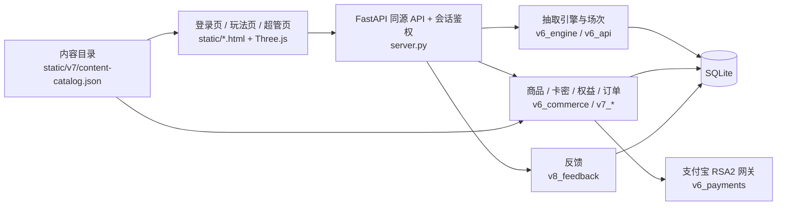

# 抽了马 Choulema · 3D 抽奖 / 随机抽取平台

> **免费抽，尽兴玩。** 一个可自托管的 3D 抽奖网站：名单抽奖、抽吃什么、分组、随机点名，三台免费 3D 机台（转盘 / 扭蛋 / 名字星球），服务端决定结果、公平可审计。
>
> **Free to draw, fun to play.** A self-hostable 3D lucky-draw web app with server-authoritative, auditable results.

[中文](#中文) · [English](#english)

---

## 中文

### 简介
抽了马（Choulema）是一个基于 **Python FastAPI + SQLite + 原生 JavaScript / Three.js** 的 3D 抽奖平台。前端负责沉浸式 3D 演出与音效，所有抽取结果在服务端生成并落库，渲染器只展示结果，保证公平、可复核。项目同时包含账号体系、会员权益、卡密、邀请、订单与支付宝直连、超管后台和用户反馈等完整运营能力。

### 功能
- 🎰 **三款免费 3D 机台**：透明极光转盘、扭蛋机、名字星球；多主题（默认 / 星空）与配套音效。
- 🧾 **四种用途**：名单抽奖、抽吃什么、随机分组、随机点名；支持不重复抽取、批量揭晓、主持 / 大屏分离。
- 👤 **账号**：邮箱验证码注册，账号 ID 自动生成；支持邮箱或 ID 登录、会话撤销、限流。
- 💎 **商业化（可关闭）**：会员 / 皮肤权益、HMAC 卡密、邀请奖励、订单、支付宝电脑 / 手机网站支付（RSA2 验签）、退款。
- 🛠 **超管后台**：用户、商品价格、活动、订单、审计、数据统计、反馈收件箱。
- 💬 **问题与建议**：游客 / 用户提交反馈，查看进度与公开回复。
- 🔒 **安全**：同源校验、请求边界、最后管理员保护、生产 preflight 检查；密钥与数据库不入代码。
- 📱 多尺寸适配、全屏与键盘（空格）操作。

### 架构

详细说明见 [planning/v8/ARCHITECTURE.md](planning/v8/ARCHITECTURE.md)。

### 快速开始
需要 Python 3.11+（前端测试需 Node 20+）。

```bash
git clone <repo-url> choulema && cd choulema
python -m venv .venv
. .venv/bin/activate            # Windows: .\.venv\Scripts\Activate.ps1
pip install -r requirements.txt
python scripts/start_local.py   # 打开 http://127.0.0.1:8908/login.html
```
Windows 也可直接运行 `.\scripts\start_v8.ps1`（`-Port 8912` 换端口，`-Admin` 初始化本地超管）。本地模式使用独立的 `data/v8-local.sqlite`，自动关闭在线销售。

运行测试：
```bash
pip install -r requirements-dev.txt
python -m pytest
node --test tests/
```

### 配置
所有配置通过**环境变量**读取，参考 [`.env.example`](.env.example)（开发）与 [`deploy/production.env.example`](deploy/production.env.example)（生产）。示例文件不会被自动加载。

| 变量 | 说明 |
|---|---|
| `LOTTERY_ENV` | `development` / `production` |
| `LOTTERY_DB` | SQLite 路径（生产放在代码目录之外） |
| `LOTTERY_PUBLIC_URL` | 站点公网地址 |
| `LOTTERY_CARD_SECRET` | 卡密 HMAC 密钥，32+ 位随机值，生成后长期保留 |
| `LOTTERY_ADMIN_*` | 首次初始化超管（启动后请移除密码） |
| `LOTTERY_MAIL_CONFIG_FILE` / `LOTTERY_SMTP_*` | 邮箱验证码 SMTP，见 `deploy/mail.example.json` |
| `ALIPAY_*`、`V6_SALES_ENABLED` | 支付宝直连与在线销售开关（默认关闭） |
| `LOTTERY_BACKUP_DIR` | 备份目录 |

生产部署（systemd、反向代理、备份、升级回退）见 [deploy/README.md](deploy/README.md)。

### 目录结构
```
.
├── server.py              # FastAPI 入口、账号与安全
├── db.py                  # 数据库结构与迁移
├── email_auth.py          # 邮箱验证码
├── request_security.py    # 请求来源 / 边界校验
├── v6_*.py                # 抽取引擎、API、商品、支付
├── v7_*.py                # 内容目录、权益、邀请、运营、统计、版本
├── v8_feedback.py         # 用户反馈
├── static/                # 前端页面、Three.js 舞台、主题与音频
│   ├── v6/ v7/            # 机台、主题、UI 模块
│   ├── v7-preview/        # 音效 / 视觉评审素材（测试引用）
│   └── vendor/            # three.module.js
├── scripts/               # 本地启动、数据库维护、打包、音频生成
├── deploy/                # systemd、生产配置示例、备份
├── tests/                 # pytest 与 node:test 测试
├── planning/              # 产品规划、架构、开发计划与历史设计记录
└── data/                  # 本地数据库（不入库）
```

### 参与贡献
欢迎 Issue 与 PR，详见 [CONTRIBUTING.md](CONTRIBUTING.md)。安全问题请私下联系维护者。

### 许可证
[Apache License 2.0](LICENSE)。第三方组件（Three.js 为 MIT）与音频素材许可见 `static/v7/audio/CREDITS.txt`。

---

## English

### Introduction
Choulema is a 3D lucky-draw platform built with **Python FastAPI + SQLite + vanilla JavaScript / Three.js**. The browser renders immersive 3D animations and sound, while every draw result is generated and persisted on the server — the renderer only displays it, keeping results fair and auditable. It also ships a full operations stack: accounts, memberships, redeem codes, referrals, orders with direct Alipay integration, an admin console and user feedback.

### Features
- 🎰 **Three free 3D machines**: aurora wheel, capsule machine, name sphere; multiple themes with matching sound sets.
- 🧾 **Four use cases**: prize draw from a name list, "what to eat", random grouping, random roll call; no-repeat draws, batch reveal, host / big-screen separation.
- 👤 **Accounts**: email-code sign-up with auto-generated IDs, login by email or ID, session revocation, rate limiting.
- 💎 **Optional monetization**: memberships / skins, HMAC redeem codes, referrals, orders, Alipay PC & mobile web payments (RSA2), refunds.
- 🛠 **Admin console**: users, pricing, campaigns, orders, audit log, analytics, feedback inbox.
- 💬 **Feedback** loop for guests and users with public replies.
- 🔒 **Security**: same-origin checks, request boundaries, last-admin protection, production preflight; no secrets or databases in the repo.

### Architecture
See the diagram above and [planning/v8/ARCHITECTURE.md](planning/v8/ARCHITECTURE.md) (Chinese).

### Quick start
Requires Python 3.11+ (Node 20+ for front-end tests).
```bash
python -m venv .venv && . .venv/bin/activate
pip install -r requirements.txt
python scripts/start_local.py   # http://127.0.0.1:8908/login.html
```
On Windows: `.\scripts\start_v8.ps1` (`-Port`, `-Admin`). Tests: `python -m pytest` and `node --test tests/`.

### Configuration
Everything is configured via environment variables; see [`.env.example`](.env.example) and [`deploy/production.env.example`](deploy/production.env.example). Key ones: `LOTTERY_ENV`, `LOTTERY_DB`, `LOTTERY_PUBLIC_URL`, `LOTTERY_CARD_SECRET`, `LOTTERY_ADMIN_*`, `LOTTERY_SMTP_*`, `ALIPAY_*`, `V6_SALES_ENABLED` (sales off by default). Production deployment: [deploy/README.md](deploy/README.md).

### Directory structure
See the tree in the Chinese section above.

### Contributing
Issues and PRs are welcome — see [CONTRIBUTING.md](CONTRIBUTING.md). Please report security issues privately.

### License
[Apache License 2.0](LICENSE).
