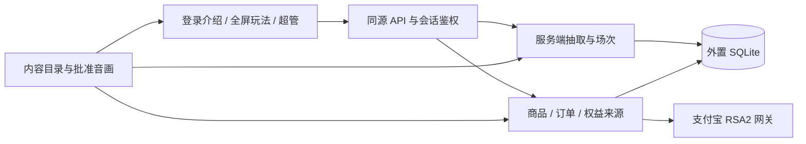

# V8 架构与增值内容扩展

## 1. 分层与可信边界

渲染器只消费结果，不决定正式中奖者。前端做可用性提示，服务端做账号、所有权、主持权、兼容和权益校验。支付回调不信任浏览器付款标志。内容目录是受版本控制的可信配置，不允许后台加载任意脚本。

## 2. 代码地图

| 领域 | 主要文件 | 修改约束 |
|---|---|---|
| HTTP / 账号 / 安全 | `server.py`、`db.py`、`email_auth.py`、`request_security.py` | 会话撤销、最后管理员、来源与请求边界必须保留 |
| 抽取与场次 | `v6_engine.py`、`v6_api.py` | 幂等、库存、不重复、主持/大屏令牌分离 |
| 商品、卡密与权益 | `v6_commerce.py`、`v7_entitlements.py` | 按来源发放/撤销；旧权益 ID 不删除 |
| 支付与退款 | `v6_payments.py` | 验签、金额、订单快照、未知状态恢复；不由基础执行者单独改动 |
| 邀请、运营和统计 | `v7_referrals.py`、`v7_operations.py`、`v7_analytics.py`、`v7_api.py` | 规则版本、事务、审计、真实口径 |
| 内容和版本 | `v7_catalog.py`、`v7_release.py`、`release.json`、`static/v7/content-catalog.json` | 前后端同源目录；应用版本相同，schema 独立演进 |
| 游戏协调与基础舞台 | `static/v6/studio.js`、`static/v6/stage.js`、运动/相机模块 | 空格/全屏、并发请求、事件阶段与资源释放 |
| 星空和声音 | `static/v7/theme-stage.mjs`、`stellar-stage.js`、`aurora-wheel.mjs`、音频模块 | 兼容旧场次与素材；批准声音逐字节保留 |
| 页面与适配 | `static/login.html`、`play.html`、`admin.html`、`static/v7/` CSS/页面模块 | 三页、游戏内弹层、移动端可达性 |
| 运维交付 | `scripts/manage_db.py`、`preflight.py`、`package_preview.py`、`start_local.py`、`deploy/` | 数据与密钥不入包，兼容升级，失败不覆盖已有数据 |

`v6`/`v7` 是稳定模块和 API 路径，不是当前产品版本。V8 不搬迁这些路径、不重命名数据库表或已售 ID。减少无行为收益的改动，便于低风险升级。

## 3. 内容扩展契约

唯一目录为 `static/v7/content-catalog.json`，包含 `machines / themes / capabilities / products`。前端选择器与后端授权读取同一数据。新增内容先给稳定 ID，登记规则、机台兼容范围、基础呈现、权益与商品；未经确认不能写入价格或上架销售。

主题必须绑定兼容机台和可用声音。新机台必须有免费基础呈现；首发 wheel/capsule/sphere 继续免费。新功能在服务端按 capability 授权，不能只隐藏按钮。`pro` 只涵盖已经承诺的能力，独立功能包可单独定义权益。

相同运动变体可以复用 `stage_id`；全新机台仍需实际开发模型、运动、相机与音频事件，仅修改 JSON 不会生成机台。渲染器保留 `configure/start/reveal/revealGroups/reset/dispose` 等现有协议。创建、切换和销毁必须配对释放 GPU、RAF 与音源。

已出售的内容 ID、订单快照和卡密语义不可改写。商品下架只停止新销售，已有持有者继续使用；紧急内容停用是独立行为，有版本检查、原因和审计。改名不改历史订单，退役须单独设计迁移与用户权益处理。

## 4. 数据与运行配置

- `data/` 仅供本地开发；生产库通常为 `/var/lib/choulema/lottery.sqlite`。
- `LOTTERY_CARD_SECRET` 是持续密钥，升级保留；不是每版随机重新生成。
- 生产环境、管理员初始化密码和支付宝私钥不由源码提供；首次初始化后移除密码环境变量。
- 管理员保存的价格、邀请活动和可用状态优先于初始化默认值；目录升级不得覆盖运营配置。
- 本地启动器只访问 `data/v8-local.sqlite`，剥离继承的生产配置。生产使用 systemd 配置与 `preflight`。
- 当前采用单进程 SQLite；扩容前独立评估共享限流、验证码、支付并发、事务和数据库迁移。

## 用户反馈模块（2026-10-09）

`v8_feedback.py` 独立处理反馈数据与接口，经 `v7_api.install` 挂载 `/api/v7/feedback` 和 `/api/v7/admin/feedback`。普通接口只按已校验身份读取自己的记录；管理员接口必须通过当前账号状态、临时密码和 superadmin 角色检查。无效登录态不能降级为游客绕过限制。

`db.init_db` 创建反馈表、回复表和索引，并幂等导入旧反馈。新提交用事务串行完成归属校验、重复请求检查、限流和写入；同请求不同内容返回冲突。身份摘要可阻止打开表单后切账号造成误提交。管理员按 revision 保存状态/回复，审计与回复在同一事务；并发旧版本不能覆盖或重复回复。

共享用户组件为 `static/v7/feedback.mjs`，请求状态与受限诊断字段在 `feedback-state.mjs`；后台详情在 `admin-feedback.mjs`。回复与描述按纯文本转义显示。独立原生 dialog 复用三页，避免新增主路由；玩法的键盘处理在 dialog 打开期间不会触发抽取。

联系邮箱只供超管查看；管理员备注和账号编号不进入用户响应。没有上传名单、截图附件或自动通知邮件。保留密钥摘要而非原始网络地址，随业务库统一备份。

## 5. 版本与交付

产品版本由 `release.json.version` 与内容目录 `version` 一致定义为 8.0.0，schema 仍为 1。健康接口返回版本与状态，不返回文件路径或密钥。

每个包具有 `PACKAGE.json`，记录来源、版本、未提交状态及每个文件的长度和 SHA-256。完整源码包保留测试与音色基准；部署包只交付运行和运维需要的内容。脱离 Git 后可以依照清单重新构建，不能将未知工作区假称为干净提交。

V8 后续小修复使用 8.0.x；新增兼容内容使用 8.x；破坏兼容前需迁移方案和独立验收。不因版本升级重置免费承诺、价格、已购期限、名单或历史记录。
